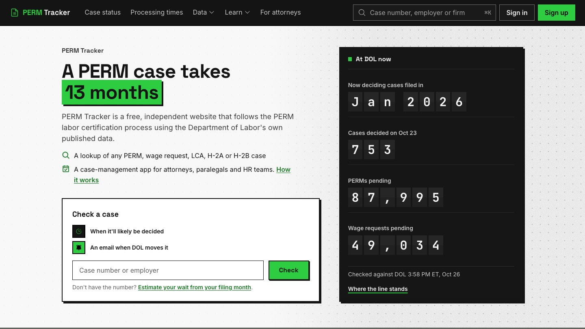

# PERM Tracker

Free PERM case status and DOL data for people waiting on a green card, and case tracking for the attorneys who file them.

**Live at [permtracker.app](https://permtracker.app)**

[](https://github.com/adamjali/perm/actions/workflows/test.yml)



## For people waiting on a case

- Case status for PERM, wage requests, H-1B LCAs, H-2A, H-2B and CW-1
- Search by employer, law firm, state, job or city
- DOL's queue and processing times
- Visa bulletin history
- Free calculators
- Email alerts, no account needed
- A free API and MCP server ([permtracker.app/developers](https://permtracker.app/developers))

## For attorneys

- Case tracking with every PERM deadline worked out
- RFI and RFE tracking
- Reminders by email, browser push and in the app
- Google Calendar sync
- An AI assistant for your cases

Every figure comes from the agency that publishes it. Sources: [permtracker.app/methodology](https://permtracker.app/methodology).

## Run it locally

You need Node 24 and pnpm.

```bash
cd v2
cp .env.example .env.local    # then fill it in
pnpm install
npx convex dev                # terminal 1
pnpm dev                      # terminal 2
```

Then open http://localhost:3000.

Before you push:

```bash
pnpm check
```

## More

- [v2/CLAUDE.md](v2/CLAUDE.md): the developer guide
- [perm_flow.md](perm_flow.md): how the PERM process works
- [v2/TEST_README.md](v2/TEST_README.md): tests
- [v2/docs/API.md](v2/docs/API.md): the Convex API

## License

All rights reserved. See [LICENSE](LICENSE). The source is published for reference only.
