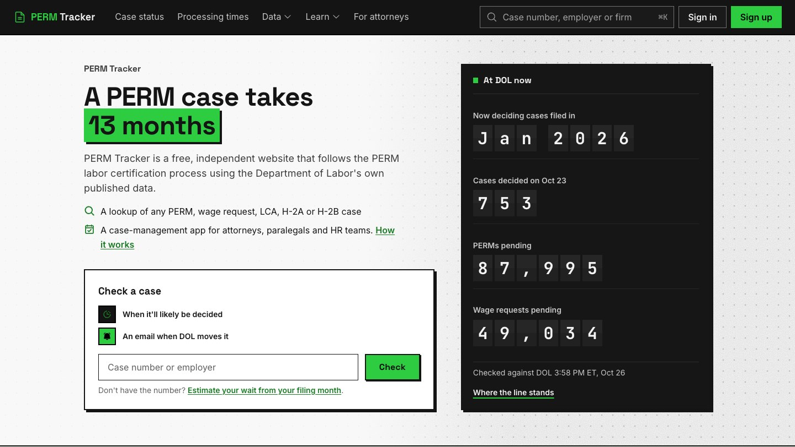

# PERM Tracker

**Federal labor-certification data, read from the source, for the people waiting on a case and the attorneys filing them.**


[](https://github.com/adamjali/perm/actions/workflows/test.yml)


**Live:** https://permtracker.app



---

## What this is

Two products sharing one corpus.

**The public side** starts from one question: *where is my case, and when is it likely to move?* Anyone can look up a case number in any Department of Labor foreign-labor program, search by employer, law firm, worksite state or occupation, and read what DOL has published about wages, queue position and decision activity. No account required.

**The application** is case management for immigration attorneys: deadline calculation under 20 CFR 656.40, cascade logic, recruitment windows, notifications and calendar sync.

The public side isn't marketing for the app. It's the larger half by traffic and by page count, and it's what the data pipeline exists to serve.

---

## Where the data comes from

Every dataset has a first-party source of record. There are **zero live third-party data dependencies**.

| Dataset | Source | Cadence |
|---|---|---|
| Per-case status, every program | DOL `flag.dol.gov` batch API | A full sweep and two pending sweeps a day; watched cases every 5 minutes on weekdays |
| New filings | DOL, found by a serial walk and by visitor lookups | Twice a day; lookups instant |
| Decided cases, wages, worksites | DOL quarterly disclosure files | Quarterly, checked monthly |
| Processing times | DOL FLAG | Hourly on weekdays |
| Visa bulletin, visa issuances | US State Department | Hourly on weekdays / monthly |
| Form medians, I-140 and I-485 counts | USCIS quarterly and monthly files | Quarterly / monthly |
| Layoff (WARN) notices | 47 state labor agencies and DC | Daily |
| Job, wage and place reference data | O\*NET, BLS, Census, BEA | Yearly |

DOL runs every foreign-labor program off one case-number counter, and this reads all of them:

| Program | Prefix | What it is |
|---|---|---|
| PERM | `G-100-` | The permanent labor certification itself |
| Prevailing wage determination | `P-100-` | ETA-9141, the wage a job must legally pay |
| H-1B labor condition application | `I-200-`, `I-203-` | ETA-9035, the wage and worksite commitment |
| H-2A, H-2B and CW-1 | `H-300-`, `H-400-`, `JO-A-300-`, `C-500-`, `P-400-` | Seasonal and CW-1 applications, job orders and wage requests |

**Each program is published twice and needs both halves.** The live endpoint covers pending cases but never returns the wage; the quarterly file carries the wage but only for decided cases. Reading one and not the other is how a page ends up claiming a determination was issued when there isn't one on it.

---

## What's in the corpus

Figures read on the site on October 26, 2026.

| What | Cases |
|---|---|
| Decided PERM cases in DOL's current files (October 2023 to June 2026) | 373,939 |
| PERM cases DOL's live service holds beyond those files | 161,996 |
| Decided wage requests | 634,638 |
| H-1B LCAs with the wage offered | 3,754,961 |

Older PERM decisions reach back to FY2016. The site publishes **312,683 URLs** across 67 sitemaps: content and data pages, and a page for every employer, law firm, occupation, city and industry in the record, down to a single filing.

---

## Features

### Public
- Case lookup by number across PERM, PWD and LCA, which asks DOL live when the corpus hasn't seen the number
- Employer, law-firm, state and occupation search, all combinable
- Decision activity by day, reaching back to October 2023 through the published files
- Queue position, DOL's decisions day by day, and the review stages a case can sit in
- Twenty-one calculators (deadlines, filing windows, priority dates, salary, wage levels, I-140, I-485)
- Email alerts on a case, an employer, a queue month or visa-bulletin movement, all double opt-in
- A free JSON API and an MCP server for assistants

### Application
- Case CRUD with real-time sync, duplicate detection and bulk operations
- Date validation and auto-calculation per 20 CFR 656.40(c), with cascade logic for dependent dates
- RFI/RFE tracking, deadline hub, timeline view
- Notifications by email, web push and in-app
- Google Calendar sync
- AI assistant with multi-provider fallback

---

## Tech stack

| Layer | Technology |
|---|---|
| Frontend | Next.js 16.4 (App Router), React 19.3, TypeScript 6 (strict) |
| Application backend | Convex 1.47 |
| Public data | libSQL (self-hosted sqld), two databases |
| Styling | Tailwind CSS 4 + shadcn/ui |
| Auth | Convex Auth + Google OAuth |
| Email | Resend, and Cloudflare Email Workers for inbound mail |
| AI | AI SDK 7, multi-provider fallback |
| Hosting | An Oracle Cloud server behind Cloudflare (site and public data), Convex Cloud (app backend) |
| Ingest | Python, on GitHub Actions and the server's systemd timers |

**Two datastores, on purpose.** Convex holds user data and drives the authenticated app in real time. libSQL holds the public federal corpus, which is read-heavy, append-mostly and far too big to sit in a document store; the H-1B LCAs have a database of their own. The site's default database token is read-only; writes ride a separate credential.

---

## Quick start

**Prerequisites:** Node.js 24.15+, pnpm, Python 3.12+ for the ingest scripts.

```bash
cd v2
pnpm install
npx convex dev     # Terminal 1
pnpm dev           # Terminal 2
```

http://localhost:3000

Copy `.env.example` to `.env.local` and fill it in. Server-side secrets live in the Convex dashboard, not in the repo.

---

## Testing

| Command | What it runs | Time |
|---|---|---|
| `pnpm test` | Watch mode | instant |
| `pnpm check` | **The pre-push gate**: typecheckers, data script tests, source audits, eslint, and the tests a change affects | ~2 to 6 min |
| `pnpm test:run` | All 5 projects | ~12 min |
| `pnpm test:e2e` | Playwright | ~2 min |
| `pnpm typecheck` | Both typecheckers, app and Convex | ~1 min |

**Baseline: 787 files, 10,530 tests.** A run that reports meaningfully fewer has broken somewhere and doesn't count as a pass. GitHub runs the whole suite on every push, and nothing deploys until it passes.

---

## Project structure

```
v2/
├── convex/                # Application backend
│   └── lib/perm/          # Central PERM business logic (canonical)
├── src/
│   ├── app/               # Routes: (site), (authenticated), api, v1, mcp
│   ├── components/        # React components
│   ├── lib/db/         # Public-data read layer (server-only)
│   └── lib/perm/          # Frontend re-exports of the Convex logic
├── content/               # MDX: blog (27), guides (86), changelog (14)
├── scripts/               # Python ingest and audit scripts
└── test-utils/
```

**All PERM business logic lives in `convex/lib/perm/` and nowhere else.** Deadline, validation and cascade rules are never reimplemented in a component.

---

## Documentation

| | |
|---|---|
| [v2/CLAUDE.md](v2/CLAUDE.md) | **Primary developer guide.** Patterns, gotchas, post-mortems |
| [perm_flow.md](perm_flow.md) | The PERM process itself, canonical |
| [v2/docs/API.md](v2/docs/API.md) | Convex API reference |
| [v2/TEST_README.md](v2/TEST_README.md) | Test infrastructure |
| [.planning/codebase/](.planning/codebase/) | Seven codebase deep-dives |

Some documents under `.planning/codebase/` are dated snapshots and their counts have drifted. `v2/CLAUDE.md` and `pnpm test:run` are current; treat the rest as orientation.

---

## Deployment

Pushing to `main` builds the site on GitHub, and it goes live in the nightly window between 1 and 5 AM Eastern, once the full test suite has passed. Every deploy empties the page cache, so deploys are batched. Convex functions deploy separately with `npx convex deploy -y` from `v2/`.

`convex/_generated/` is committed, because the build runs from git and would otherwise typecheck against a stale API.

---

## Security

- Convex Auth with row-level access: users reach only their own data
- The site's default database credential is read-only; writes use a separate token
- Public HTTP endpoints are rate-limited per identity and with a global budget on the shared resource
- Action tokens are purpose-scoped, so a link meaning one thing can't be replayed as another
- Cloudflare in front, per-address and per-crawler limits at the server, security headers, HTTPS enforced, an idle sign-out

---

## License

**All rights reserved.** See [LICENSE](LICENSE). The source is published for reference. It isn't open source, and you don't get permission to use, copy, modify or distribute it.

---

## Acknowledgments

- [DOL Office of Foreign Labor Certification](https://flag.dol.gov/programs/perm)
- [20 CFR 656](https://www.ecfr.gov/current/title-20/chapter-V/part-656)
- US Department of State visa bulletin, USCIS processing data

---

**Built with Claude Code** · **Last updated:** October 2026
